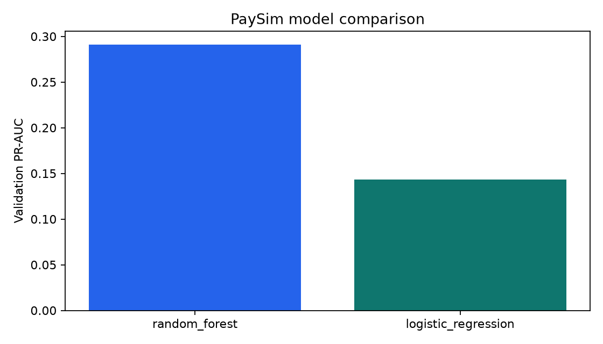
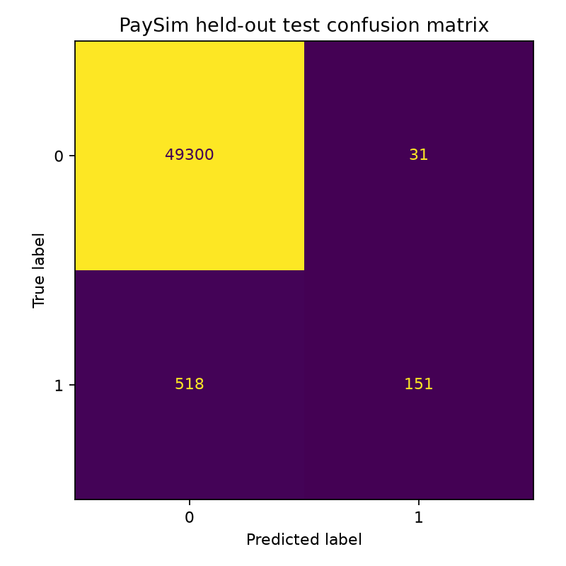

# PaySim Mobile-Money Fraud Detection ML

This is a standalone, ML-only project for the PaySim synthetic mobile-money dataset. It uses chronological
train/validation/test periods, compares class-weighted logistic regression and random forest models, selects
the winner by validation PR-AUC, and evaluates it once on the held-out test period.

## Dataset source

- [PaySim on Kaggle](https://www.kaggle.com/datasets/ealaxi/paysim1)
- Licence: CC BY-SA 4.0
- Target: `isFraud`
- Time field: `step` (one hour per step)

The project does not redistribute the raw CSV. PaySim is synthetic and its results do not establish
performance on real customers or real mobile-money systems.

## Open in PyCharm on this Mac

Open this folder as a separate PyCharm project:

```text
/Users/daoduykha/Documents/Playground/paysim-fraud-ml
```

In PyCharm, choose **Settings → Project → Python Interpreter → Add Interpreter → Virtualenv** and create
`.venv` inside the project. Then run in the PyCharm terminal:

```bash
python -m pip install --upgrade pip
python -m pip install -e ".[dev]"
```

## Download the dataset

Accept the dataset terms on Kaggle and configure a Kaggle API token. Then run:

```bash
python scripts/download_paysim.py
```

Expected file:

```text
data/raw/PS_20174392719_1491204439457_log.csv
```

You can also download it manually from Kaggle and place it at that path.

## Run the complete workflow

Run these commands from the project root:

```bash
python preprocess_data/run.py
python training_model/train.py
python evaluation/evaluate.py
```

Run a local prediction after training:

```bash
python -m paysim_fraud.inference examples/sample_transaction.json
```

Run the optional local API:

```bash
python -m uvicorn paysim_fraud.api:app --host 127.0.0.1 --port 8030
```

Open <http://127.0.0.1:8030/docs>.

## Team folder layout

| Folder | Purpose |
| --- | --- |
| `checkpoint/` | Fitted `.joblib` pipeline and model card |
| `dataset/` | Dataset source, licence, and expected raw-file location |
| `evaluation/` | Evaluation entrypoint and links to report outputs |
| `preprocess_data/` | Validation, temporal splitting, and profiling entrypoint |
| `preprocessed_df/` | Reproducible train-ready sampled table |
| `training_model/` | Model-training entrypoint |
| `utils/` | Shared project path helpers |
| `src/paysim_fraud/` | Main implementation |
| `outputs/` | Metrics, prediction CSV files, and PNG charts |

Some files are intentionally short. `.gitkeep` preserves an empty folder in Git, `__init__.py` marks a
Python package, and the workflow entrypoints call the shared implementation under `src/`.

## Leakage and laptop controls

- Splits are chronological by `step`; the test period is not used for selection or threshold tuning.
- `isFlaggedFraud` is excluded because it is an existing business-rule result.
- Raw account IDs are excluded to avoid identity memorisation.
- Balance-before and balance-after fields are excluded because PaySim's dataset notes warn about their use.
- Only the five required raw columns are loaded, reducing memory use on a Mac.
- Each time period has a configurable row cap in `configs/training.json`; sampling occurs after splitting and
  preserves the fraud class ratio.
- Class weighting is fitted only on the training period.

## Outputs

After training, [open the evaluation guide](evaluation/README.md) or the `outputs/` folder. Expected files:

- `dataset_profile.json`: provenance, SHA-256, row counts, fraud rate, and missing values
- `model_comparison.csv`: validation metrics for both models
- `metrics.json`: selected model and held-out test metrics
- `test_predictions.csv`: held-out labels and fraud scores
- `model_comparison.png`
- `precision_recall_curves.png`
- `confusion_matrix.png`
- `prediction_distribution.png`

### Current trained result

Random forest was selected by validation PR-AUC. The held-out 50,000-row test sample produced PR-AUC
0.3069, ROC-AUC 0.8529, precision 0.8297, and recall 0.2257. See [all evaluation files](outputs/) and the
[evaluation guide with chart previews](evaluation/README.md).





## Tests

```bash
pytest -q
ruff check .
```

The tests use generated records and do not require the 494 MB dataset.

## Citation

E. A. Lopez-Rojas, A. Elmir, and S. Axelsson, “PaySim: A financial mobile money simulator for fraud
detection,” 28th European Modeling and Simulation Symposium, 2016.
